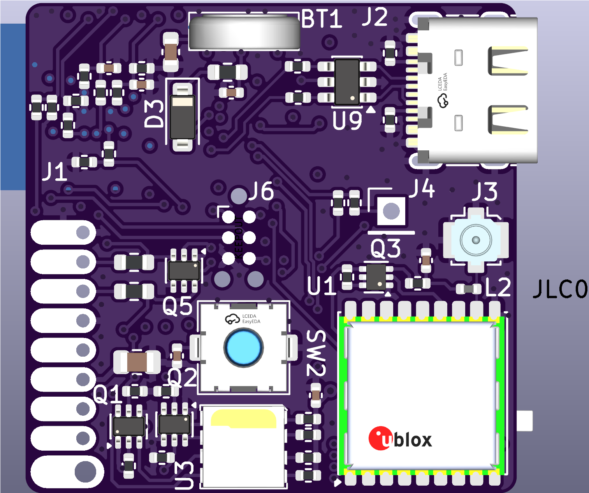

# Nikon-NMEA-Pro

A low-power GNSS logger and BLE remote shutter for Nikon cameras with the 10-pin connector. It is a work in progress: the hardware is designed, the PCB has not been built or tested, and the firmware has not been started.

*Front of the PCB.*

## Goals

Older GPS units for Nikon cameras (GP-1, Solmeta GMAX) typically draw tens of mA continuously, are slow to get a cold fix, and have no wireless connectivity. This 35 x 35 mm module aims to improve on them:

- Standby draw of tens of µA instead of tens of mA
- Fast fixes by injecting assistance data (u-blox AssistNow) from a smartphone over BLE
- Four-constellation tracking with a u-blox M10 receiver
- BLE remote shutter and USB-C file access

| Status | Item |
| :--- | :--- |
| Done | Schematic and PCB layout |
| Pending | PCB fabrication and assembly |
| Pending | Power measurements (all current figures below are datasheet estimates) |
| Not started | Firmware |

## Camera connection

> [!NOTE]
> I connect the module to my Nikon D200 using a **Nikon MC-35 cable** (GPS adapter cable for RS232). I have not verified compatibility with other bodies or cables.

## Planned features

- **EXIF geotagging:** convert GNSS position and barometric altitude into 5 V TTL NMEA sentences for the camera.
- **Hot-shoe X-sync logging:** read the X-sync contact and write a `<wpt>` tag to the GPX log when the shutter fires.
- **Motion-aware track logging:** log GPX tracks to a 16 MB SPI NOR flash chip, pausing when the accelerometer shows the camera is stationary.
- **USB-C mass storage:** mount as a flash drive for drag-and-drop GPX access.
- **BLE remote:** trigger autofocus and shutter release from a smartphone app via MOSFET outputs.
- **Auto-wake:** monitor `V_CC` on the 10-pin connector and wake from System OFF when the camera powers on.

## Hardware

### Processing and communications

| Function | Part | Notes |
| :--- | :--- | :--- |
| MCU | u-blox BMD-340-A-R (nRF52840) | BLE, USB MSC, sensor fusion, NMEA generation |
| Level shifting | TI TXU0202 | 3V3 -> 5V for Camera UART |

### GNSS and sensors

- **Receiver:** u-blox MAX-M10S (GPS, Galileo, GLONASS, BeiDou concurrently).
- **Antenna:** active antenna on a U.FL connector, powered through a bias-T. A MOSFET driven by `LNA_EN` cuts antenna power when the GNSS is asleep.
- **Compass:** ST LSM303AGR (I2C), for tilt-compensated heading in `$--HDG` sentences.
- **Barometer:** Bosch BMP581 (I2C), for altitude.

### Power

The board can be powered from USB (5 V) or the camera (`V_BAT`, up to 8.4 V).

- **Source selection:** Nexperia BAV170 dual diode, chosen for very low reverse leakage to prevent backfeed.
- **Regulation:** TI TPS70933 3.3 V LDO. Accepts inputs above 30 V with about 1 µA quiescent current.
- **Backup:** Seiko MS621FE rechargeable coin cell, trickle-charged in normal use. It is intended to keep the u-blox RTC and orbital data alive for a few days with the camera battery removed, preserving fast fixes after a battery swap (about 4.5 days estimated).

## PCB

- **Size:** 35 x 35 mm, 4 layers.
- **Stackup:** JLC04161H-3313 (0.09 mm dielectric between L1 and L2).
- **RF:** 50 Ω coplanar waveguide with ground (CPWG) for the 1.5 GHz GNSS path.

### Assembly

Components are on both sides, so assembly is planned as two-stage soldering to keep the bottom side from shifting:

1. Bottom side (including hidden LGA pads): lead-free paste, reflowed on a hot plate at ~220 °C.
2. Top side: leaded paste, hot air at ~183 °C, below the bottom side's solidus so those joints stay solid.

## Estimated power budget

These are summed datasheet typical values, not measurements.

| State | Component | Current |
| :--- | :--- | :--- |
| Sleep | nRF52840 (System OFF) | ~1.0 µA |
| Sleep | MAX-M10S (software standby) | ~46.0 µA |
| Sleep | `V_BAT` ADC divider (3.2 MΩ) | ~2.6 µA |
| Sleep | I2C sensors, flash, LDO quiescent | ~3.8 µA |
| | **Total standby (estimated)** | **~53.4 µA** |
| Active | Full system (BLE, 4-GNSS, sensors, USB) | **~22 mA** |

At roughly 53 µA, standby would take over 3 years to drain a 1500 mAh battery, ignoring the battery's own self-discharge. Real numbers will be measured once the board is built.

## Firmware

Not started. The plan is Zephyr RTOS, with hardware interrupt handling, LittleFS wear leveling on the SPI flash, BLE GATT profiles, and USB mass storage.
